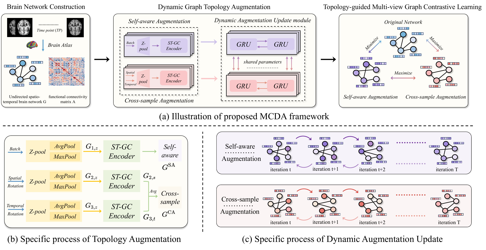
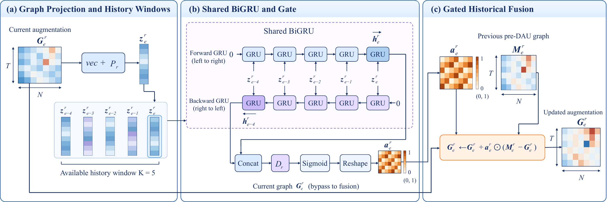
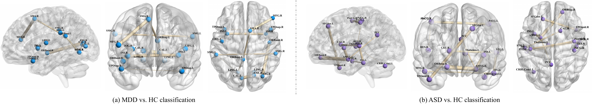

<div align="center">

# MCDA

### Multi-View Graph Contrastive Learning with Dynamic Topology Augmentation for Functional MRI Analysis

[](https://arxiv.org/abs/2610.26322)
[](https://arxiv.org/pdf/2610.26322)
[](#code-release)

**Hao Zhang<sup>1,2</sup>, Xiaoyun Liu<sup>3</sup>, Shuo Huang<sup>2</sup>, Yue Ma<sup>4</sup>, Liang Cao<sup>5</sup>, Mingxia Liu<sup>6</sup>, Li Zhang<sup>2</sup>**

<sup>1</sup> Fudan University &nbsp;&nbsp; <sup>2</sup> Nanjing Forestry University<br>
<sup>3</sup> Southeast University &nbsp;&nbsp; <sup>4</sup> Jiangsu Health Vocational College<br>
<sup>5</sup> Taian Tumor Hospital &nbsp;&nbsp; <sup>6</sup> University of North Carolina at Chapel Hill

**arXiv preprint · October 2026**

[Paper](https://arxiv.org/abs/2610.26322) · [PDF](https://arxiv.org/pdf/2610.26322) · [Citation](#citation)

<p align="center">
  <a href="img/framework.webp">
    
  </a>
</p>

</div>

## Overview

**MCDA** is a topology-guided multi-view graph contrastive learning framework for resting-state functional MRI (rs-fMRI) analysis and brain disorder identification. It combines **self-aware** and **cross-sample** brain network augmentations with history-guided refinement, learning from subject-specific functional patterns and inter-subject variability.

The framework jointly optimizes diagnostic classification and multi-view contrastive learning. The original and two augmented views share a classification branch, and their predicted patient probabilities are averaged during both training and testing.

Experiments cover **REST-MDD** and **ABIDE**, with **1,236 subjects** in total. The paper also analyzes the similarity-score optimization directions and a lower bound of the contrastive objective.

## Dynamic Augmentation Update (DAU) Module

DAU summarizes recent augmentation histories with a **shared BiGRU** and generates element-wise gates to blend each current augmented view with its branch-specific historical reference.

[](img/DAU_Module.png)

## Exploratory Analysis of Brain Region-Level Associations

We explore model-derived brain region associations for **MDD vs. HC** on REST-MDD and **ASD vs. HC** on ABIDE. The selected connectivity patterns provide exploratory anatomical context for the learned brain network representations.

[](img/Discriminative_FCs.jpg)

## Code Release

The implementation is being organized for a structured public release. Setup instructions, dependencies, and training and evaluation commands will accompany the code release.

## To-do List

- [x] Release the paper on arXiv.
- [x] Add paper information, the framework, and module illustrations.
- [ ] Organize, clean, and release the source code.
- [ ] Add environment setup and dependency requirements.
- [ ] Add data preparation, training, and evaluation instructions.

## Citation

If you find this work useful, please cite:

```bibtex
@misc{zhang2026mcda,
  title         = {{MCDA}: Multi-View Graph Contrastive Learning with Dynamic Topology Augmentation for Functional {MRI} Analysis},
  author        = {Hao Zhang and Xiaoyun Liu and Shuo Huang and Yue Ma and Liang Cao and Mingxia Liu and Li Zhang},
  year          = {2026},
  eprint        = {2610.26322},
  archivePrefix = {arXiv},
  url           = {https://arxiv.org/abs/2610.26322}
}
```
