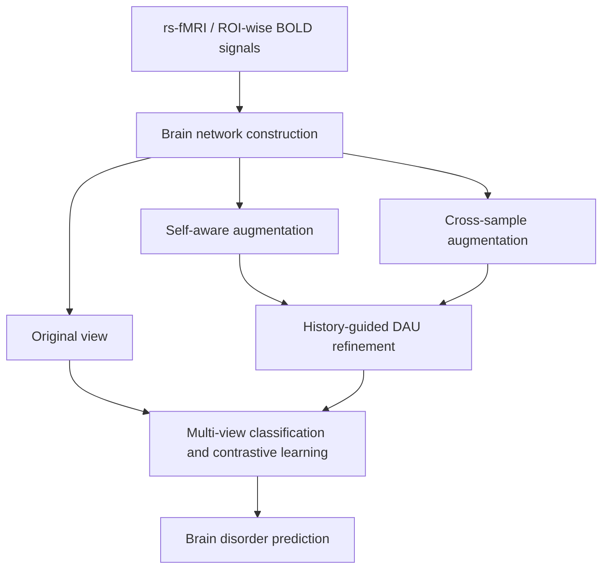

# MCDA

[](https://arxiv.org/abs/2610.26322)
[](#to-do-list)

**MCDA: Multi-View Graph Contrastive Learning with Dynamic Topology Augmentation for Functional MRI Analysis**

Hao Zhang, Xiaoyun Liu, Shuo Huang, Yue Ma, Liang Cao, Mingxia Liu, and Li Zhang

**Preprint:** arXiv:2610.26322 · Submitted on October 19, 2026

[Paper](https://arxiv.org/abs/2610.26322) · [PDF](https://arxiv.org/pdf/2610.26322) · [Citation](#citation)

## Overview

MCDA is a topology-guided multi-view graph contrastive learning framework for resting-state functional MRI (rs-fMRI) analysis and brain disorder identification. It combines complementary brain network augmentations with history-guided refinement to learn from both subject-specific functional patterns and inter-subject variability.

The framework has four main components:

1. **Brain network construction.** Represent ROI-wise BOLD signals and functional connectivity as brain network inputs.
2. **Complementary view generation.** Generate a self-aware view to capture subject-specific patterns and a cross-sample view to incorporate perturbations from other subjects.
3. **Dynamic Augmentation Update (DAU).** Use augmentation histories across training epochs to refine the current augmented views through gated fusion.
4. **Joint classification and contrastive learning.** Combine diagnostic supervision with consistency and diversity constraints between the original and augmented views and between the two augmented views.

The three views use a shared classification branch, and their predicted patient probabilities are averaged during both training and testing.



The paper also analyzes the similarity-score optimization directions and a lower bound of the contrastive objective. Experiments cover two public rs-fMRI datasets, **REST-MDD** and **ABIDE**, with **1,236 subjects** in total.

## Code Release

The implementation is being organized for a structured public release. This repository currently provides the paper information, method overview, and citation. Setup and usage instructions will accompany the code release.

## To-do List

- [x] Release the paper on arXiv.
- [x] Add paper information and a method overview.
- [ ] Organize, clean, and release the source code.
- [ ] Add environment setup and dependency requirements.
- [ ] Add data preparation, training, and evaluation instructions.

## Citation

If you find this work useful, please cite:

```bibtex
@misc{zhang2026mcda,
  title         = {{MCDA}: Multi-View Graph Contrastive Learning with Dynamic Topology Augmentation for Functional {MRI} Analysis},
  author        = {Hao Zhang and Xiaoyun Liu and Shuo Huang and Yue Ma and Liang Cao and Mingxia Liu and Li Zhang},
  year          = {2026},
  eprint        = {2610.26322},
  archivePrefix = {arXiv},
  url           = {https://arxiv.org/abs/2610.26322}
}
```
